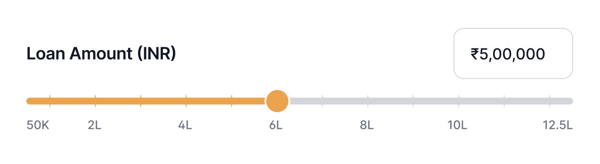
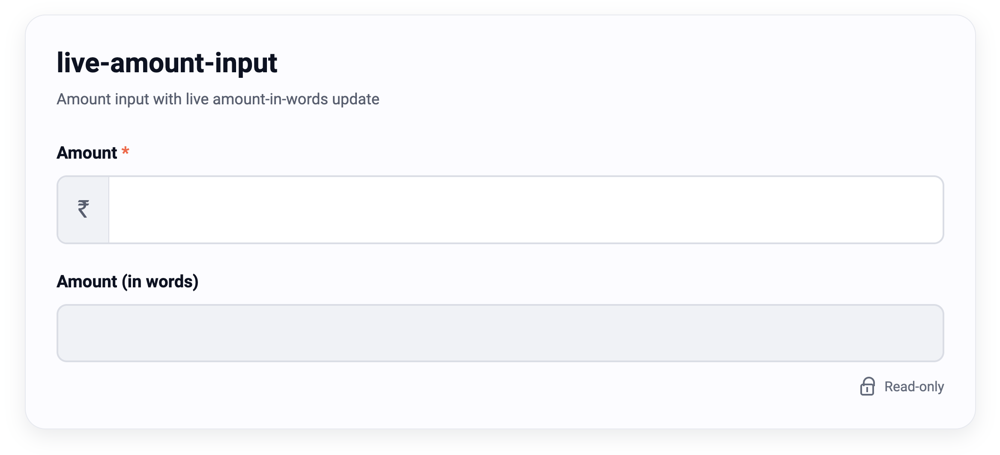
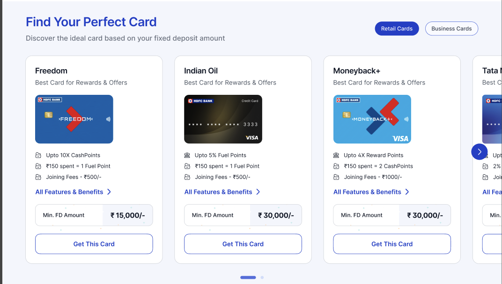

# Custom component prompts (original, verbatim)

The four component requests exactly as originally written, with their reference screenshots. Use these unchanged as the input for each benchmark run.

## 1. Loan slider component

Create a loan amount slider component that has a max and min amount set by user and accordingly generates equal splits, has a slider head the user can slide, also a text-box that displays the current value the slider head is pointing to. If user changes the textbox values the slider updates and vice versa

## 2. Image choice component

Create a custom component as shown in the image. Its an image choice and the choice can be either single or multi which should be configurable by the user. 

## 3. inr-input

Create a custom form component named inr-input with an editable Indian Rupee (₹) amount field and a read-only amount-in-words field below it. The amount-in-words should update live as the customer types, using the Indian numbering system (Thousand, Lakh, Crore) and supporting Rupees and Paise.

## 4. Card choice component

Create a custom component called card choice that populates a cards with data. A rule triggers and sets the data on the component in the shape  of an array of objects having the card details. The component should handle the rendering of the cards with all the data as shown. The component should have carousal behaviour where the cards can be scrolled horizontally. When customer selects a card details in the view its details should be selected in the model
